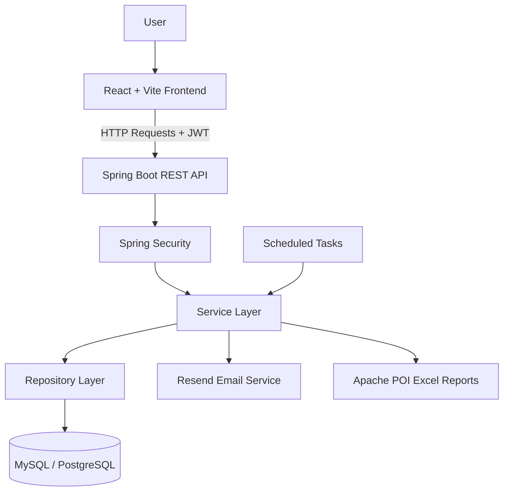

# 💰 Money Manager

<p align="center">
  
  
  
  
</p>

<p align="center">
  <b>A full-stack personal finance management application to track income, manage expenses, analyze spending, and generate financial reports.</b>
</p>

<p align="center">
  <a href="https://moneymanagerui.onrender.com/login">
    
  </a>
  
  
</p>

---

## 📌 Overview

**Money Manager** is a full-stack personal finance management system built to help users organize their finances and gain insights into their spending habits.

The application provides a centralized platform for recording income and expenses, managing transaction categories, visualizing financial activity through dashboard analytics, and generating downloadable Excel reports.

It also integrates automated email notifications and scheduled financial summaries to help users stay informed about their financial activity.

## ✨ Features

### 🔐 Authentication and Security
- User registration and login.
- JWT-based authentication.
- Email verification and account activation.
- Password encryption and secure API access.
- Spring Security-based request authorization.

### 💸 Income and Expense Management
- Record and manage income transactions.
- Track expenses and spending patterns.
- Organize transactions using categories.
- Filter financial records to find relevant transactions.
- Maintain structured financial records.

### 📊 Dashboard and Analytics
- View a consolidated overview of financial activity.
- Analyze income and expenses.
- Visualize financial trends using dashboard charts.
- Review transaction data for better financial decision-making.

### 📧 Automated Email Notifications
- Scheduled financial summaries.
- Email reminders and notifications.
- Resend integration for email delivery.

### 📑 Excel Reports
- Generate downloadable Excel reports.
- Export financial records using Apache POI.
- Organize transaction data for offline analysis and record keeping.

### ⚙️ Backend Engineering
- RESTful API architecture.
- Layered application structure.
- DTO-based request and response handling.
- Input validation and centralized exception handling.
- Database persistence using Spring Data JPA and Hibernate.

## 🛠️ Tech Stack

<p align="center">
  
</p>

| Category | Technologies |
|---|---|
| **Languages** | Java, JavaScript, SQL |
| **Frontend** | React, Vite, Tailwind CSS |
| **Backend** | Java, Spring Boot, Spring MVC, REST APIs |
| **Security & Authentication** | Spring Security, JWT, BCrypt |
| **Database & ORM** | MySQL, PostgreSQL, Spring Data JPA, Hibernate |
| **Caching** | Redis |
| **Email Services** | Resend, scheduled email notifications |
| **Report Generation** | Apache POI, Excel export |
| **Scheduling & Automation** | Spring Scheduler, scheduled background tasks |
| **Build & Dependency Management** | Maven |
| **API Testing** | Postman |
| **Deployment & DevOps** | Render, Git, GitHub, Docker |

### 🔌 Integrations & Libraries

- **Resend** — Transactional email delivery and notification workflows.
- **Redis** — In-memory caching for supported application data.
- **Apache POI** — Programmatic generation and export of Excel spreadsheets.
- **Spring Security + JWT** — Authentication and protection of REST endpoints.
- **Spring Data JPA + Hibernate** — Database persistence and object-relational mapping.
- **Spring Scheduler** — Execution of scheduled background tasks.


## 🏗️ Architecture



The application follows a layered architecture that separates frontend presentation, API handling, business logic, and database persistence.

- **Frontend:** Provides the user interface for managing transactions and viewing financial analytics.
- **Controller layer:** Exposes REST endpoints and handles HTTP requests.
- **Service layer:** Implements transaction management, business rules, and reporting logic.
- **Repository layer:** Handles database operations through Spring Data JPA.
- **Security layer:** Protects endpoints using Spring Security and JWT authentication.
- **Integration layer:** Supports email delivery through Resend and Excel report generation through Apache POI.

## 🔄 Application Workflow

1. Users register and activate their accounts through email verification.
2. Users log in and authenticate API requests using JWT.
3. Income and expense records are submitted through the frontend.
4. The Spring Boot backend validates requests and persists records in the database.
5. Dashboard endpoints provide financial data for analytics and visualizations.
6. Users can export financial records as Excel reports.
7. Scheduled tasks support email reminders and financial summaries.

## 🚀 Live Demo

Try the deployed application:

**[Open Money Manager](https://moneymanagerui.onrender.com/login)**

> Note: The availability of the live demo depends on the hosting environment.

## 💻 Run Locally

### Prerequisites

Ensure the following tools are installed:

- Java 17 or a compatible version required by the project.
- Node.js and npm.
- MySQL.
- Maven, or the project's Maven Wrapper.
- A Resend API key for email features.

### 1. Clone the Repository

```bash
git clone https://github.com/devch105/moneymanagerUI.git
cd moneymanagerUI
```

The frontend and backend repositories may be separate. If so, clone and configure each repository independently.

### 2. Configure the Backend

Configure your Spring Boot application properties or YAML file with your database connection and email settings.

Example configuration:

```yaml
spring:
  datasource:
    url: ${DB_URL}
    username: ${DB_USERNAME}
    password: ${DB_PASSWORD}

  jpa:
    hibernate:
      ddl-auto: update

resend:
  api-key: ${RESEND_API_KEY}
```

Adapt these property names to match the configuration keys used in your backend. Keep credentials in environment variables and never commit secrets.

### 3. Start the Backend

From the backend project directory, run:

```bash
./mvnw spring-boot:run
```

On Windows:

```powershell
mvnw.cmd spring-boot:run
```

Alternatively, use `mvn spring-boot:run` if Maven is installed globally.

### 4. Configure the Frontend

Create a `.env` file in the frontend project directory:

```env
VITE_API_BASE_URL=http://localhost:8080
VITE_CLOUDINARY_CLOUD_NAME=your_cloudinary_cloud_name
```

Use the exact backend URL and API base path expected by your frontend configuration.

### 5. Start the Frontend

```bash
npm install
npm run dev
```

Open the local URL displayed by Vite in your terminal.

## 🔒 Security Considerations

- Never expose API keys, database passwords, or JWT signing secrets in frontend code.
- Configure CORS to allow only trusted frontend origins in production.
- Validate incoming requests before processing transactions.
- Protect private endpoints with appropriate authentication and authorization rules.
- Use environment variables for deployment-specific configuration.
- Prefer database migration tools and controlled schema updates for production environments.

## 🗺️ Future Improvements

Potential enhancements include:

- Budget planning and spending limits.
- Recurring income and expense tracking.
- Advanced monthly and yearly analytics.
- Savings goals and financial forecasting.
- Improved mobile-responsive dashboards.
- Automated testing and continuous integration.

## 👨‍💻 Author

**Dev Dhama**

<p align="left">
  <a href="https://github.com/devch105">
    
  </a>
  <a href="https://leetcode.com/u/devch105/">
    
  </a>
</p>

---

<p align="center">
  Built with ❤️ using Java, Spring Boot, and React.
</p>
